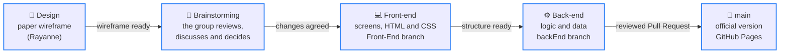
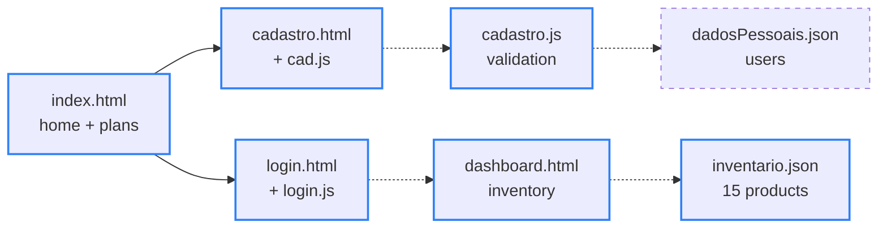

<div align="center">

# 📦 OrganizeMe

> 🌐 Leia em [Português](./README.md)

[](#-development-workflow)

[](#️-technologies-used)

[](https://briandevbr.github.io/OrganizeMe/)
[](https://youtu.be/VDhH5xvdti0)
[](./LICENSE)
[](#-features)
[](#-team-and-context)
[](https://github.com/briandevbr/OrganizeMe/commits/main)

`HTML · CSS · vanilla JavaScript · no build step · MIT`

**[🌐 Open the web version](https://briandevbr.github.io/OrganizeMe/)** &nbsp;·&nbsp; **[🎬 git clone tutorial](https://youtu.be/VDhH5xvdti0)** &nbsp;·&nbsp; **[👋 Welcome guide](https://briandevbr.github.io/OrganizeMe/welcome.html)**

</div>

**OrganizeMe** is a web platform for financial management and inventory control: login and sign-up screens, subscription plans and a dashboard where the inventory will come to life. It's an academic project built by 22 hands, by the 2nd-period ADS (Systems Analysis and Development) class. **MVP in progress:** the screens and the sign-up validation already exist; back-end integration and inventory control come next.

> [!TIP]
> **Just joined the team?** Start with the [welcome guide](https://briandevbr.github.io/OrganizeMe/welcome.html) (`welcome.html`, in Portuguese): leadership, terminal, Git, commit conventions and branch rules, with a copy button on every command. Never cloned a repository? [Davi Perrelli's video tutorial](https://youtu.be/VDhH5xvdti0) walks through `git clone` step by step.

---

## 📑 Table of Contents

- [🗂️ Project Structure](#️-project-structure)
- [🗂️ Project Structure - tree](#️-project-structure---tree)
- [🧭 Development workflow](#-development-workflow)
- [👥 Team and context](#-team-and-context)
- [🔄 How it works](#-how-it-works)
- [🗄️ Data model](#️-data-model)
- [📰 Business Rules](#-business-rules)
- [⚙️ Technologies used](#️-technologies-used)
- [🚀 How to run](#-how-to-run)
- [✨ Features](#-features)
- [🤝 Contributing](#-contributing)
- [📄 License](#-license)

---

## 🗂️ Project Structure

| Path | Description |
|---|---|
| `index.html` | Home page, at the root so GitHub Pages can serve it: product pitch, animated cards, 3 plans (Free, Intermediate and Advanced) and Help, Register and Login buttons |
| `welcome.html` | Welcome guide for newcomers: team workflow, leadership, first day, terminal, Git, commits, tools and branch rules. A standalone page with inline styles and scripts |
| `back/bancoDeDados/dadosPessoais.json` | Intended storage for users' sign-up data. It's empty for now, since no server writes to it yet |
| `back/bancoDeDados/inventario.json` | Sample inventory of 15 backpacks, each with `id`, `quantidade` (quantity) and `preco` (price) (see [Data model](#️-data-model)) |
| `back/codigoFonte/cad.js` | Sign-up screen script: show/hide password on the "Senha" (password) and "Confirmar Senha" (confirm password) fields, plus visual indicators of the password rules on submit |
| `back/codigoFonte/cadastro.js` | Sign-up validation module (e-mail format, password rules and a username without spaces). Exports `login()`, which no page calls yet |
| `back/codigoFonte/login.js` | Show/hide password on the login screen |
| `front/CSS/cadastro.css` | Sign-up styles: animated gradient background, inputs with icons, headings in the Kolak font and the password-rule indicators (`.msg-erro` / `.ativo`) |
| `front/CSS/dashboard.css` | Dashboard styles: fixed gradient top bar, toolbar strip and product area |
| `front/CSS/estilo.css` | Home page styles: animated gradient, buttons with a *pulse* effect, cards that fan out on hover and plan cards with an entrance animation |
| `front/CSS/login.css` | Login screen styles with an animated gradient background |
| `front/CSS/fontes/Golos-Text.ttf` | Golos Text font. The file is in the repo, but no `@font-face` loads it yet |
| `front/fonts/KOLAK.ttf` | Kolak font, used in headings via `@font-face` |
| `front/HTML/cadastro.html` | "Criar conta" (create account) form: full name, e-mail, password with rule indicators and password confirmation |
| `front/HTML/dashboard.html` | Dashboard v0.1-alpha: bar with a profile button, add/remove buttons, a tag field and a product area (layout only) |
| `front/HTML/login.html` | Login screen: e-mail, password with show/hide, a "Esqueci minha senha" (forgot password) link and a shortcut to sign-up |
| `.gitignore` | Ignores OS files (`.DS_Store`, `Thumbs.db`), `node_modules/`, `.env` and `.vscode/` |
| `Icone.ico` | Favicon for the home, sign-up, login and welcome pages |
| `LICENSE` | The project's MIT license text |
| `README.en.md` | This documentation in English |
| `README.md` | This documentation in Portuguese |

---

## 🗂️ Project Structure - tree

```
🗂️
├── 📁 back
│  ├── 📁 bancoDeDados
│  │  ├── 📈 dadosPessoais.json
│  │  └── 📈 inventario.json
│  └── 📁 codigoFonte
│     ├── ⚙️ cad.js
│     ├── ⚙️ cadastro.js
│     └── ⚙️ login.js
├── 📁 front
│  ├── 📁 CSS
│  │  ├── 📁 fontes
│  │  │  └── 📄 Golos-Text.ttf
│  │  ├── 🎨 cadastro.css
│  │  ├── 🎨 dashboard.css
│  │  ├── 🎨 estilo.css
│  │  └── 🎨 login.css
│  ├── 📁 fonts
│  │  └── 📄 KOLAK.ttf
│  └── 📁 HTML
│     ├── 🌐 cadastro.html
│     ├── 🌐 dashboard.html
│     └── 🌐 login.html
├── 🔧 .gitignore
├── 🖼️ Icone.ico
├── 🌐 index.html
├── 🗒️ LICENSE
├── 🇺🇸 README.en.md
├── 🇧🇷 README.md
└── 🌐 welcome.html
```

---

## 🧭 Development workflow

Every OrganizeMe feature follows the same path, **always in this order**. A stage only starts once the previous one delivers.



<sub>Each arrow is a hand-off: without it, the next stage doesn't start. Front and Back reach `main` through a Pull Request reviewed by the leads.</sub>

| Stage | Led by | Output | Rule to move on |
|---|---|---|---|
| 🎨 **1. Design** | Rayanne Melo | The screen's wireframe, drawn on paper | The project only moves forward after this stage |
| 🧠 **2. Brainstorming** | The whole group | Decision on what changes from the wireframe | Decided as a group, before anyone opens the editor |
| 💻 **3. Front-end** | Front-end Squad | Screens, HTML, CSS and pages on the `Front-End` branch | Structure ready before the back-end steps in |
| ⚙️ **4. Back-end** | Back-end Squad | Logic and data applied on top of the finished structure, on the `backEnd` branch | Reaches `main` only through a reviewed Pull Request |

---

## 👥 Team and context

**Collaborative academic project** by 2nd-period Systems Analysis and Development (ADS) students at Centro Universitário Maurício de Nassau (Olinda/PE), for the Coding course led by professor Filipe Araújo. The project belongs to the whole group: 11 people, two squads and a design stage that opens every cycle.

### 🧑‍✈️ Leadership

| Role | Who |
|---|---|
| 👑 General Repository Lead · Back-end Squad Lead | [David Brian](https://github.com/briandevbr) |
| 🤝 Repository Co-lead · Front-end Squad Lead | [Davi Perrelli](https://github.com/DaviPerrelli15) |
| 🎨 Design: the wireframes that open every cycle | [Rayanne Melo](https://github.com/rayannemelo222) |

### ⚔️ Squads

| ⚙️ Back-end Squad | 💻 Front-end Squad |
|---|---|
| **David Brian** (lead) | **Davi Perrelli** (lead) |
| Carlos Henrique | Guilherme Cauã |
| Thiago Guimarães | Kauã Heinzel |
| Miguel Arthur | Thiago Guimarães |
| | Pedro Madson |
| | Rayanne Melo |

<sub>Thiago Guimarães works in both squads.</sub>

### 🌟 The people building OrganizeMe

<table>
  <tr>
    <td align="center" width="25%"><a href="https://github.com/briandevbr"><br/><b>David Brian</b></a><br/><sub>👑 Leadership · ⚙️ Back-end</sub></td>
    <td align="center" width="25%"><a href="https://github.com/DaviPerrelli15"><br/><b>Davi Perrelli</b></a><br/><sub>🤝 Co-leadership · 💻 Front-end</sub></td>
    <td align="center" width="25%"><a href="https://github.com/rayannemelo222"><br/><b>Rayanne Melo</b></a><br/><sub>🎨 Design · 💻 Front-end</sub></td>
    <td align="center" width="25%"><a href="https://github.com/thiagoguimaraessf-afk"><br/><b>Thiago Guimarães</b></a><br/><sub>⚙️ Back-end · 💻 Front-end</sub></td>
  </tr>
  <tr>
    <td align="center" width="25%"><a href="https://github.com/carloshenrique1611"><br/><b>Carlos Henrique</b></a><br/><sub>⚙️ Back-end</sub></td>
    <td align="center" width="25%"><a href="https://github.com/miguelarthur202"><br/><b>Miguel Arthur</b></a><br/><sub>⚙️ Back-end</sub></td>
    <td align="center" width="25%"><a href="https://github.com/gui-cauadev"><br/><b>Guilherme Cauã</b></a><br/><sub>💻 Front-end</sub></td>
    <td align="center" width="25%"><a href="https://github.com/kauaheinzel"><br/><b>Kauã Heinzel</b></a><br/><sub>💻 Front-end</sub></td>
  </tr>
  <tr>
    <td align="center" width="25%"><a href="https://github.com/PedroMadsonDevBr"><br/><b>Pedro Madson</b></a><br/><sub>💻 Front-end</sub></td>
    <td align="center" width="25%"><a href="https://github.com/BigEddie-png"><br/><b>Eduardo Willian</b></a><br/><sub>🧩 OrganizeMe team</sub></td>
    <td align="center" width="25%"><a href="https://github.com/v1ninato"><br/><b>Renato Vinícius</b></a><br/><sub>🧩 OrganizeMe team</sub></td>
    <td align="center" width="25%"></td>
  </tr>
</table>

**Tutor:** [Filipe Araújo](https://github.com/FilipeHSAraujo)

---

## 🔄 How it works



<sub>Blue border = already in the code · dashed border = next steps · dotted arrow = not wired up yet</sub>

Navigation between screens already works: from the home page, the Register and Login buttons (and the plan buttons) lead to the sign-up and login screens, and those two screens link to each other. On the sign-up screen, `cad.js` lights up each satisfied password rule in green (8 characters, special character, uppercase letter and number) when you click **Cadastrar Empresa** (register company). What's missing is wiring the pieces together: the form doesn't call `cadastro.js` yet, login doesn't lead to the dashboard yet, and nothing is written to JSON.

The most interesting part of the code is the validation in `cadastro.js`: a chain of checks with early returns. Each rule that fails returns `{ erro }` (error) with that rule's message and stops there; only when everything passes does the function return `{ dados }` (data), with the e-mail and username already trimmed. The order is: valid e-mail → password with 8+ characters → special character (`!@#$%*`) → uppercase letter → no spaces in the password → no spaces in the username.

Real output (Node.js 22). The error messages are in Portuguese, as in the code:

```text
login("ana@empresa",        "Senha@123",  "ana")        → { erro: "email invalido" }
login("ana@empresa.com",    "senha1",     "ana")        → { erro: "a senha precisa ter mais de 8 caracteres" }
login("ana@empresa.com",    "senha123",   "ana")        → { erro: "1 caractere especial ex: !@#$%*" }
login("ana@empresa.com",    "senha@123",  "ana")        → { erro: "precisa de 1 letra maiuscula" }
login("ana@empresa.com",    "Senha@ 123", "ana")        → { erro: "a senha nao pode ter espacos em branco" }
login("ana@empresa.com",    "Senha@123",  "ana souza")  → { erro: "usuario nao pode conter espaco" }
login("  ana@empresa.com ", "Senha@123",  "  ana  ")    → { dados: { email: "ana@empresa.com", senha: "Senha@123", username: "ana" } }
```

> [!NOTE]
> The screen rules (`cad.js`) and the module rules (`cadastro.js`) aren't identical yet: the screen asks for a number and the module doesn't. That's why `login("ana@empresa.com", "Senha@ab", "ana")` passes in the module. Unifying them is listed under [Features](#-features).

---

## 🗄️ Data model

For now, the "databases" are JSON files in `back/bancoDeDados/`.

**`inventario.json`**: a `produtos` (products) object whose keys are the product names.

| Field | Type in the file | Example | Notes |
|---|---|---|---|
| *(key)* | string | `"Mochila Gamer Para Notebook Até 17 Polegadas Acolchoada"` | Full product name |
| `id` | string | `"8"` | Sequential from `"1"` to `"15"`, no repeats. It's the basis for RN04 |
| `quantidade` (quantity) | string | `"120"` | 80 to 800 units per product; 4,230 in total |
| `preco` (price) | string | `"289"` | Price in BRL, from R$ 35 to R$ 289 |

- **Coverage:** 15 products, all backpacks.
- **Quirk:** numbers are stored as strings, so they need converting before adding or comparing. As strings, `"80" > "100"` is true.

**`dadosPessoais.json`**: empty file (0 bytes), reserved for registered users.

---

## 📰 Business Rules

- **RN01:** the system must log product entries and exits.
- **RN02:** the system must automatically update the available quantity after a movement.
- **RN03:** the system must alert when a product reaches the minimum stock level.
- **RN04:** each product must have a unique identifier code.
- **RN05:** the system must log who was responsible for each movement.
- **RN06:** products with a quantity of zero must be flagged as "Out of stock".
- **RN07:** access to certain functions must depend on the user's permission level.

The business scope also covers: temporary product reservation during checkout, tracking the reservation's expiration deadline, updating stock after payment confirmation, deducting stock upon order shipment, and automatically releasing reserved products when the reservation expires or payment isn't confirmed.

None of these rules are implemented yet. They are the scope of the inventory dashboard (see [Features](#-features)).

---

## ⚙️ Technologies used

- [HTML5](https://developer.mozilla.org/en-US/docs/Web/HTML): structure of the 5 pages (home, sign-up, login, dashboard and welcome guide)
- [CSS3](https://developer.mozilla.org/en-US/docs/Web/CSS): layout, animated gradients with `@keyframes`, a *pulse* effect on buttons and cards with hover transforms
- Vanilla JavaScript: show/hide password, password-rule indicators, plan entrance animation with [IntersectionObserver](https://developer.mozilla.org/en-US/docs/Web/API/Intersection_Observer_API), sign-up validation (ES module) and the welcome guide's interactivity
- [Font Awesome](https://fontawesome.com/) 6 (CDN): icons on the sign-up and login screens
- [Lucide](https://lucide.dev/): dashboard icons, as SVG embedded in the HTML
- [Inter](https://fonts.google.com/specimen/Inter) (Google Fonts): home page text; the local Kolak font is used for headings
- [GitHub Pages](https://pages.github.com/): hosting for the [web version](https://briandevbr.github.io/OrganizeMe/)
- Git + GitHub: version control, one branch per squad and reviewed Pull Requests
- [VS Code](https://code.visualstudio.com/) with [Live Server](https://marketplace.visualstudio.com/items?itemName=ritwickdey.LiveServer) and [Prettier](https://marketplace.visualstudio.com/items?itemName=esbenp.prettier-vscode): the team's standard setup (configuration in the [welcome guide](https://briandevbr.github.io/OrganizeMe/welcome.html))
- [Node.js](https://nodejs.org/) (planned: back-end server and saving data to JSON)

---

## 🚀 How to run

**Just want to look?** Open the [web version](https://briandevbr.github.io/OrganizeMe/), published from `main`. Nothing to install.

**Want to run it and change the code?** Prerequisites: [Git](https://git-scm.com/downloads) and [VS Code](https://code.visualstudio.com/) with the [Live Server](https://marketplace.visualstudio.com/items?itemName=ritwickdey.LiveServer) extension. If you've never cloned a repository, watch [Davi Perrelli's git clone tutorial](https://youtu.be/VDhH5xvdti0) first.

```bash
git clone https://github.com/briandevbr/OrganizeMe.git
cd OrganizeMe
code .
```

In VS Code, right-click `index.html` (at the project root) and choose **"Open with Live Server"**. The browser opens `http://127.0.0.1:5500/index.html` with the home page and the 3 plans; the Register and Login buttons lead to the sign-up and login screens. The dashboard isn't linked from the other screens yet: open `front/HTML/dashboard.html` directly with Live Server. Icons and the Inter font come from a CDN, so you need an internet connection.

To try the sign-up validation in the terminal (optional, requires [Node.js](https://nodejs.org/) 22.7+):

```bash
node --input-type=module -e 'import { login } from "./back/codigoFonte/cadastro.js"; console.log(login("ana@empresa.com", "senha123", "ana"))'
# { erro: '1 caractere especial ex: !@#$%*' }
```

---

## ✨ Features

**Progress: 9 of 18 steps done**

- [x] Home page with the product pitch, animated cards and 3 plans (Free, Intermediate at R$ 19.99/month and Advanced at R$ 29.99/month) with an entrance animation that respects `prefers-reduced-motion`
- [x] Sign-up screen with show/hide password on the "Senha" and "Confirmar Senha" fields
- [x] Visual password-rule indicators on sign-up: 8 characters, special character, uppercase letter and number
- [x] Login screen with show/hide password, a "forgot password" link and a shortcut to sign-up
- [x] Sign-up validation module (`cadastro.js`): e-mail format, password with 8+ characters, a special character, an uppercase letter and no spaces, username without spaces
- [x] Dashboard layout (v0.1-alpha): bar with a profile button, add/remove buttons, a tag field and a product area
- [x] Sample inventory of 15 products in JSON
- [x] Web version published on GitHub Pages
- [x] Welcome guide (`welcome.html`) for newcomers
- [ ] Password confirmation on sign-up (in progress on the `Front-End` branch)
- [ ] Unify the password rules of `cad.js` and `cadastro.js` and wire the validation into the form
- [ ] Authentication: login leading to the dashboard, with a profile shortcut and redirects depending on whether the user is logged in
- [ ] "Forgot password" flow (only the link exists today)
- [ ] Node.js server saving users to `dadosPessoais.json`
- [ ] Working dashboard: add and remove inventory items, logging entries/exits and who made them (RN01, RN02, RN04, RN05)
- [ ] Minimum-stock alert and "Out of stock" flag (RN03, RN06)
- [ ] Access control by permission level (RN07)
- [ ] Help Center: FAQ accordion and support channels (e-mail, chat, WhatsApp)

---

## 🤝 Contributing

OrganizeMe belongs to the whole group, and everyone contributes through the same flow. Before your first commit, go through the [welcome guide](https://briandevbr.github.io/OrganizeMe/welcome.html): it explains every command, with a copy button.

**Branches**

| Branch | Used by | Purpose |
|---|---|---|
| `main` | Leadership | Official version, published on GitHub Pages. Nobody pushes to it directly: everything goes in through a reviewed Pull Request |
| `Front-End` | Front-end Squad | Screens, styles and in-browser interactions |
| `backEnd` | Back-end Squad | Logic, data and business rules |

**Step by step**

1. Switch to your squad's branch and pull the latest changes: `git checkout Front-End` (or `backEnd`) and `git pull`.
2. Code in small commits, one topic at a time.
3. Run `git pull` again and send your work with `git push` to the squad branch.
4. The leads open the Pull Request to `main` and review it before merging.

**Commits** follow the [Conventional Commits](https://www.conventionalcommits.org/en/v1.0.0/) standard: `type(scope): description`, with a present-tense verb, in lowercase and without a trailing period. The team writes descriptions in Portuguese. Types in use: `feat`, `fix`, `docs`, `style`, `refactor` and `chore`. Real examples from the history:

```text
feat(cadastro): adiciona indicadores visuais para validação de senha
refactor(senha): renomeia elementos de erro para nomes semanticos
docs(senha): adiciona comentarios explicativos nas regras de validacao
chore: adiciona .gitignore e remove .DS_Store do versionamento
```

Suggestions from outside the team are welcome via [issues](https://github.com/briandevbr/OrganizeMe/issues).

---

## 📄 License

Distributed under the [MIT](./LICENSE) license: use, study and adapt it freely, keeping the copyright notice. The third-party fonts included in the repository (Kolak and Golos Text) follow their own authors' licenses.

---

<div align="center">
  <sub>Made by the OrganizeMe team 💙 · 2nd-period ADS · UNINASSAU Olinda</sub><br/>
  <sub>Design → Brainstorming → Front-end → Back-end</sub>
</div>
