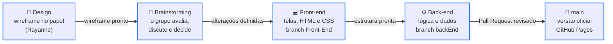
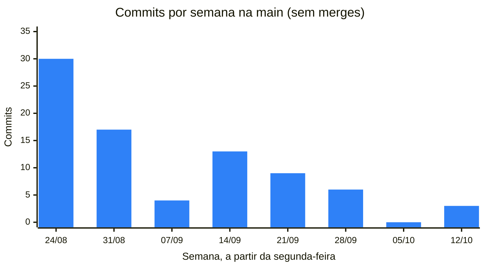
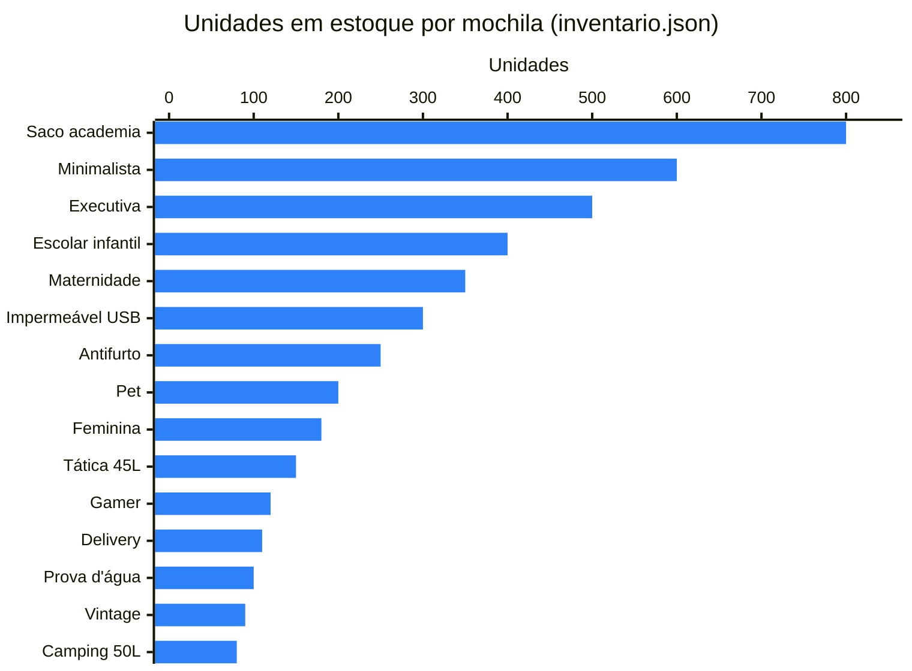
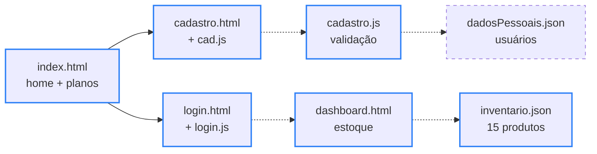

<div align="center">

# 📦 OrganizeMe

> 🌐 Read this in [English](./README.en.md)

[](#-fluxo-de-desenvolvimento)

[](#️-tecnologias-usadas)

[](https://briandevbr.github.io/OrganizeMe/)
[](https://youtu.be/VDhH5xvdti0)
[](./LICENSE)
[](#-funcionalidades)
[](#-time-e-contexto)
[](https://github.com/briandevbr/OrganizeMe/commits/main)

`HTML · CSS · JavaScript puro · sem build · MIT`

**[🌐 Abrir a versão web](https://briandevbr.github.io/OrganizeMe/)** &nbsp;·&nbsp; **[🎬 Tutorial de git clone](https://youtu.be/VDhH5xvdti0)** &nbsp;·&nbsp; **[👋 Guia de boas-vindas](https://briandevbr.github.io/OrganizeMe/welcome.html)**

</div>

O **OrganizeMe** é uma plataforma web de gestão financeira e controle de estoque: telas de login e cadastro, planos de assinatura e um dashboard onde o inventário vai ganhar vida. É um projeto acadêmico construído a 20 mãos pela turma do 2º período de ADS. **MVP em construção:** as telas e a validação do cadastro já existem; a integração com o back-end e o controle de estoque vêm a seguir.

> [!TIP]
> **Chegou agora no time?** Comece pelo [guia de boas-vindas](https://briandevbr.github.io/OrganizeMe/welcome.html) (`welcome.html`): liderança, terminal, Git, padrão de commits e regras das branches, com botão de copiar em cada comando. Nunca clonou um repositório? O [tutorial em vídeo do Davi Perrelli](https://youtu.be/VDhH5xvdti0) mostra o `git clone` passo a passo.

---

## 📑 Sumário

- [🗂️ Estrutura do Projeto](#️-estrutura-do-projeto)
- [🗂️ Estrutura do Projeto - tree](#️-estrutura-do-projeto---tree)
- [🧭 Fluxo de desenvolvimento](#-fluxo-de-desenvolvimento)
- [👥 Time e contexto](#-time-e-contexto)
- [📊 Projeto em números](#-projeto-em-números)
- [🔄 Como funciona](#-como-funciona)
- [🗄️ Modelo de dados](#️-modelo-de-dados)
- [📰 Regras de Negócio](#-regras-de-negócio)
- [⚙️ Tecnologias usadas](#️-tecnologias-usadas)
- [🚀 Como rodar](#-como-rodar)
- [✨ Funcionalidades](#-funcionalidades)
- [🤝 Contribuindo](#-contribuindo)
- [📄 Licença](#-licença)

---

## 🗂️ Estrutura do Projeto

| Caminho | Descrição |
|---|---|
| `index.html` | Página inicial, na raiz para o GitHub Pages servir: chamada do produto, cards animados, 3 planos (Free, Intermediário e Avançado) e botões Ajuda, Registrar e Login |
| `welcome.html` | Guia de boas-vindas para quem chega no time: fluxo de trabalho, liderança, primeiro dia, terminal, Git, commits, ferramentas e regras das branches. Página independente, com estilos e scripts embutidos |
| `back/bancoDeDados/dadosPessoais.json` | Destino previsto para os dados de cadastro dos usuários. Hoje está vazio, porque ainda não há servidor gravando nele |
| `back/bancoDeDados/inventario.json` | Inventário de exemplo com 15 mochilas, cada uma com `id`, `quantidade` e `preco` (ver [Modelo de dados](#️-modelo-de-dados)) |
| `back/codigoFonte/cad.js` | Script da tela de cadastro: mostrar/ocultar senha nos campos "Senha" e "Confirmar Senha" e indicadores visuais das regras de senha ao enviar o formulário |
| `back/codigoFonte/cadastro.js` | Módulo de validação do cadastro (formato do e-mail, regras de senha e usuário sem espaço). Exporta `login()`, que ainda não é chamado por nenhuma página |
| `back/codigoFonte/login.js` | Mostrar/ocultar senha da tela de login |
| `front/CSS/cadastro.css` | Estilos do cadastro: fundo em gradiente animado, inputs com ícone, títulos na fonte Kolak e os indicadores das regras de senha (`.msg-erro` / `.ativo`) |
| `front/CSS/dashboard.css` | Estilos do dashboard: barra superior fixa em gradiente, faixa de ferramentas e área de produtos |
| `front/CSS/estilo.css` | Estilos da página inicial: gradiente animado, botões com efeito *pulse*, cards que se abrem no hover e cards de planos com animação de entrada |
| `front/CSS/login.css` | Estilos da tela de login com fundo em gradiente animado |
| `front/CSS/fontes/Golos-Text.ttf` | Fonte Golos Text. O arquivo está no repo, mas nenhum `@font-face` carrega ele ainda |
| `front/fonts/KOLAK.ttf` | Fonte Kolak, usada nos títulos via `@font-face` |
| `front/HTML/cadastro.html` | Formulário "Criar conta": nome completo, e-mail, senha com indicadores de regra e confirmação de senha |
| `front/HTML/dashboard.html` | Dashboard v0.1-alpha: barra com botão de perfil, botões add/remove, campo de tags e área de produtos (só layout) |
| `front/HTML/login.html` | Tela de login: e-mail, senha com mostrar/ocultar, link "Esqueci minha senha" e atalho para o cadastro |
| `.gitignore` | Ignora arquivos de sistema (`.DS_Store`, `Thumbs.db`), `node_modules/`, `.env` e `.vscode/` |
| `Icone.ico` | Favicon da página inicial, do cadastro, do login e do guia de boas-vindas |
| `LICENSE` | Texto da licença MIT do projeto |
| `README.en.md` | Esta documentação em inglês |
| `README.md` | Esta documentação em português |

---

## 🗂️ Estrutura do Projeto - tree

```
🗂️
├── 📁 back
│  ├── 📁 bancoDeDados
│  │  ├── 📈 dadosPessoais.json
│  │  └── 📈 inventario.json
│  └── 📁 codigoFonte
│     ├── ⚙️ cad.js
│     ├── ⚙️ cadastro.js
│     └── ⚙️ login.js
├── 📁 front
│  ├── 📁 CSS
│  │  ├── 📁 fontes
│  │  │  └── 📄 Golos-Text.ttf
│  │  ├── 🎨 cadastro.css
│  │  ├── 🎨 dashboard.css
│  │  ├── 🎨 estilo.css
│  │  └── 🎨 login.css
│  ├── 📁 fonts
│  │  └── 📄 KOLAK.ttf
│  └── 📁 HTML
│     ├── 🌐 cadastro.html
│     ├── 🌐 dashboard.html
│     └── 🌐 login.html
├── 🔧 .gitignore
├── 🖼️ Icone.ico
├── 🌐 index.html
├── 🗒️ LICENSE
├── 🇺🇸 README.en.md
├── 🇧🇷 README.md
└── 🌐 welcome.html
```

---

## 🧭 Fluxo de desenvolvimento

Toda funcionalidade do OrganizeMe percorre o mesmo caminho, **sempre nesta ordem**. Uma etapa só começa quando a anterior entrega.



<sub>Cada seta é uma entrega: sem ela, a etapa seguinte não começa. Front e Back chegam na `main` por Pull Request revisado pela liderança.</sub>

| Etapa | Quem conduz | O que sai dela | Regra de passagem |
|---|---|---|---|
| 🎨 **1. Design** | Rayanne Melo | Wireframe da tela, desenhado no papel | O projeto só avança depois desta etapa |
| 🧠 **2. Brainstorming** | O grupo inteiro | Decisão do que muda em relação ao wireframe | Decidido em grupo, antes de abrir o editor |
| 💻 **3. Front-end** | Esquadrão Front-end | Telas, HTML, CSS e páginas na branch `Front-End` | Estrutura pronta antes de o back entrar |
| ⚙️ **4. Back-end** | Esquadrão Back-end | Lógica e dados aplicados sobre a estrutura pronta, na branch `backEnd` | Entra na `main` só por Pull Request revisado |

---

## 👥 Time e contexto

**Projeto acadêmico colaborativo** do 2º período de Análise e Desenvolvimento de Sistemas (ADS) do Centro Universitário Maurício de Nassau (Olinda/PE), na disciplina de Coding do professor Filipe Araújo. O projeto é de todo o grupo: 10 pessoas, dois esquadrões e uma etapa de design que abre cada ciclo.

### 🧑‍✈️ Liderança

| Papel | Quem |
|---|---|
| 👑 Líder Geral do Repositório · Líder do Esquadrão Back-end | [David Brian](https://github.com/briandevbr) |
| 🤝 Co-líder do Repositório · Líder do Esquadrão Front-end | [Davi Perrelli](https://github.com/DaviPerrelli15) |
| 🎨 Design: wireframes que abrem cada ciclo | [Rayanne Melo](https://github.com/rayannemelo222) |

### ⚔️ Esquadrões

| ⚙️ Esquadrão Back-end | 💻 Esquadrão Front-end |
|---|---|
| **David Brian** (líder) | **Davi Perrelli** (líder) |
| Carlos Henrique | Guilherme Cauã |
| Thiago Guimarães | Kauã Heinzel |
| Miguel Arthur | Thiago Guimarães |
| | Pedro Madson |
| | Rayanne Melo |

<sub>Thiago Guimarães atua nos dois esquadrões.</sub>

### 🌟 Quem constrói o OrganizeMe

<table>
  <tr>
    <td align="center" width="20%"><a href="https://github.com/briandevbr"><br/><b>David Brian</b></a><br/><sub>👑 Liderança · ⚙️ Back-end</sub></td>
    <td align="center" width="20%"><a href="https://github.com/DaviPerrelli15"><br/><b>Davi Perrelli</b></a><br/><sub>🤝 Co-liderança · 💻 Front-end</sub></td>
    <td align="center" width="20%"><a href="https://github.com/rayannemelo222"><br/><b>Rayanne Melo</b></a><br/><sub>🎨 Design · 💻 Front-end</sub></td>
    <td align="center" width="20%"><a href="https://github.com/thiagoguimaraessf-afk"><br/><b>Thiago Guimarães</b></a><br/><sub>⚙️ Back-end · 💻 Front-end</sub></td>
    <td align="center" width="20%"><a href="https://github.com/carloshenrique1611"><br/><b>Carlos Henrique</b></a><br/><sub>⚙️ Back-end</sub></td>
  </tr>
  <tr>
    <td align="center" width="20%"><a href="https://github.com/miguelarthur202"><br/><b>Miguel Arthur</b></a><br/><sub>⚙️ Back-end</sub></td>
    <td align="center" width="20%"><a href="https://github.com/gui-cauadev"><br/><b>Guilherme Cauã</b></a><br/><sub>💻 Front-end</sub></td>
    <td align="center" width="20%"><a href="https://github.com/kauaheinzel"><br/><b>Kauã Heinzel</b></a><br/><sub>💻 Front-end</sub></td>
    <td align="center" width="20%"><a href="https://github.com/PedroMadsonDevBr"><br/><b>Pedro Madson</b></a><br/><sub>💻 Front-end</sub></td>
    <td align="center" width="20%"><a href="https://github.com/v1ninato"><br/><b>Renato Vinícius</b></a><br/><sub>🧩 Equipe OrganizeMe</sub></td>
  </tr>
</table>

**Tutor:** [Filipe Araújo](https://github.com/FilipeHSAraujo)

---

## 📊 Projeto em números

| 👥 Pessoas | 🖥️ Telas | ✅ Etapas do MVP | 📝 Commits na `main` | 📦 Produtos de exemplo |
|:---:|:---:|:---:|:---:|:---:|
| **10** | **4** + guia | **9 de 18** | **82** | **15** (4.230 unidades) |

**Ritmo do time**



<sub>Contagem até 13/10/2026, pela data de autoria. A largada de agosto concentra a montagem das telas. A semana de 05/10 não teve commits na `main` porque o trabalho seguiu na branch `Front-End` (confirmação de senha).</sub>

**Estoque de exemplo**



<sub>Dados de exemplo usados pelo dashboard: 15 mochilas e 4.230 unidades no total. É sobre esses números que o alerta de estoque mínimo (RN03) vai trabalhar.</sub>

<details>
<summary>📋 Ver os números dos gráficos em tabela</summary>

| Semana (segunda-feira) | Commits |
|---|---:|
| 24/08 | 30 |
| 31/08 | 17 |
| 07/09 | 4 |
| 14/09 | 13 |
| 21/09 | 9 |
| 28/09 | 6 |
| 05/10 | 0 |
| 12/10 | 3 |

| Produto | `id` | Unidades |
|---|:---:|---:|
| Mochila Saco Esportiva Academia Treino Impermeável Leve | 13 | 800 |
| Mochila Minimalista Transversal Bag Ombro Com Trava De Segurança | 11 | 600 |
| Mochila Executiva Expansível Mala Viagem Unissex Lançamento | 2 | 500 |
| Mochila Escolar Infantil Com Rodinhas E Lancheira Térmica Kit | 7 | 400 |
| Mochila Maternidade Multifuncional Térmica Para Bebê | 9 | 350 |
| Mochila Impermeável Com Porta Usb Para Trabalho E Viagem | 3 | 300 |
| Mochila Antifurto Escolar Executiva Impermeável Entrada Usb | 4 | 250 |
| Mochila Pet Transporte Cão E Gato Com Visor Panorâmico | 14 | 200 |
| Mochila Feminina Couro Ecológico Trabalho Viagem Elegante | 5 | 180 |
| Mochila Tática Militar Camuflada Lonas Reforçada 45L | 10 | 150 |
| Mochila Gamer Para Notebook Até 17 Polegadas Acolchoada | 8 | 120 |
| Mochila Térmica Delivery Entregador Marmita E Bebidas | 15 | 110 |
| Mochila jiesipote À Prova D'água Reforçada Expansível | 1 | 100 |
| Mochila De Lona Vintage Masculina Estilo Casual Notebook | 12 | 90 |
| Mochila Esportiva Camping Trilha Ciclismo 50 Litros Impermeável | 6 | 80 |

</details>

---

## 🔄 Como funciona



<sub>Borda azul = já existe no código · borda tracejada = próximas etapas · seta pontilhada = ligação ainda não feita</sub>

A navegação entre as telas já funciona: da página inicial, os botões Registrar e Login (e os botões dos planos) levam ao cadastro e ao login, e as duas telas se linkam entre si. Na tela de cadastro, `cad.js` acende em verde cada regra de senha atendida (8 caracteres, caractere especial, letra maiúscula e número) quando você clica em **Cadastrar Empresa**. O que falta é ligar as peças: o formulário ainda não chama `cadastro.js`, o login ainda não leva ao dashboard e nada é gravado em JSON.

A parte mais interessante do código é a validação em `cadastro.js`: uma cadeia de checagens com retorno antecipado. Cada regra que falha devolve `{ erro }` com a mensagem daquela regra e para ali; só quando tudo passa a função devolve `{ dados }`, com e-mail e usuário já sem espaços nas pontas. A ordem é: e-mail válido → senha com 8+ caracteres → caractere especial (`!@#$%*`) → letra maiúscula → senha sem espaço → usuário sem espaço.

Saída real (Node.js 22):

```text
login("ana@empresa",        "Senha@123",  "ana")        → { erro: "email invalido" }
login("ana@empresa.com",    "senha1",     "ana")        → { erro: "a senha precisa ter mais de 8 caracteres" }
login("ana@empresa.com",    "senha123",   "ana")        → { erro: "1 caractere especial ex: !@#$%*" }
login("ana@empresa.com",    "senha@123",  "ana")        → { erro: "precisa de 1 letra maiuscula" }
login("ana@empresa.com",    "Senha@ 123", "ana")        → { erro: "a senha nao pode ter espacos em branco" }
login("ana@empresa.com",    "Senha@123",  "ana souza")  → { erro: "usuario nao pode conter espaco" }
login("  ana@empresa.com ", "Senha@123",  "  ana  ")    → { dados: { email: "ana@empresa.com", senha: "Senha@123", username: "ana" } }
```

> [!NOTE]
> As regras da tela (`cad.js`) e do módulo (`cadastro.js`) ainda não são idênticas: a tela pede número e o módulo não. Por isso `login("ana@empresa.com", "Senha@ab", "ana")` passa no módulo. Unificar as duas está nas [Funcionalidades](#-funcionalidades).

---

## 🗄️ Modelo de dados

Por enquanto os "bancos" são arquivos JSON em `back/bancoDeDados/`.

**`inventario.json`**: objeto `produtos`, em que a chave é o nome do produto.

| Campo | Tipo no arquivo | Exemplo | Observação |
|---|---|---|---|
| *(chave)* | texto | `"Mochila Gamer Para Notebook Até 17 Polegadas Acolchoada"` | Nome completo do produto |
| `id` | texto | `"8"` | Sequencial de `"1"` a `"15"`, sem repetição. É a base para a RN04 |
| `quantidade` | texto | `"120"` | De 80 a 800 unidades por produto; 4.230 no total |
| `preco` | texto | `"289"` | Preço em reais, de R$ 35 a R$ 289 |

- **Cobertura:** 15 produtos, todos mochilas.
- **Peculiaridade:** os números estão gravados como texto, então precisam de conversão antes de somar ou comparar. Como texto, `"80" > "100"` dá verdadeiro.

**`dadosPessoais.json`**: arquivo vazio (0 bytes), reservado para os usuários cadastrados.

---

## 📰 Regras de Negócio

- **RN01:** o sistema deve registrar a entrada e saída de produtos.
- **RN02:** o sistema deve atualizar automaticamente a quantidade disponível após uma movimentação.
- **RN03:** o sistema deve alertar quando um produto atingir o estoque mínimo.
- **RN04:** cada produto deve possuir um código identificador único.
- **RN05:** o sistema deve registrar o responsável por cada movimentação.
- **RN06:** produtos com quantidade igual a zero devem ser identificados como "Sem estoque".
- **RN07:** o acesso a determinadas funções deve depender do nível de permissão do usuário.

Além disso, o escopo de negócio prevê: reserva temporária de produtos durante o checkout, registro do prazo de expiração da reserva, atualização do estoque após confirmação de pagamento, baixa do estoque na expedição do pedido, e liberação automática de produtos reservados quando a reserva expira ou o pagamento não é confirmado.

As regras ainda não estão implementadas. Elas são o escopo do dashboard de estoque (ver [Funcionalidades](#-funcionalidades)).

---

## ⚙️ Tecnologias usadas

- [HTML5](https://developer.mozilla.org/pt-BR/docs/Web/HTML): estrutura das 5 páginas (home, cadastro, login, dashboard e guia de boas-vindas)
- [CSS3](https://developer.mozilla.org/pt-BR/docs/Web/CSS): layout, gradientes animados com `@keyframes`, efeito *pulse* nos botões e cards com transformações no hover
- JavaScript puro: mostrar/ocultar senha, indicadores das regras de senha, animação dos planos com [IntersectionObserver](https://developer.mozilla.org/pt-BR/docs/Web/API/Intersection_Observer_API), validação do cadastro (módulo ES) e a interatividade do guia de boas-vindas
- [Font Awesome](https://fontawesome.com/) 6 (CDN): ícones das telas de cadastro e login
- [Lucide](https://lucide.dev/): ícones do dashboard, em SVG embutido no HTML
- [Inter](https://fonts.google.com/specimen/Inter) (Google Fonts): texto da página inicial; a fonte Kolak, local, fica nos títulos
- [GitHub Pages](https://pages.github.com/): hospedagem da [versão web](https://briandevbr.github.io/OrganizeMe/)
- Git + GitHub: versionamento, uma branch por esquadrão e Pull Requests revisados
- [VS Code](https://code.visualstudio.com/) com [Live Server](https://marketplace.visualstudio.com/items?itemName=ritwickdey.LiveServer) e [Prettier](https://marketplace.visualstudio.com/items?itemName=esbenp.prettier-vscode): ambiente padrão do time (configuração no [guia de boas-vindas](https://briandevbr.github.io/OrganizeMe/welcome.html))
- [Node.js](https://nodejs.org/) (planejado: servidor do back-end e gravação dos dados em JSON)

---

## 🚀 Como rodar

**Só quer ver?** Abra a [versão web](https://briandevbr.github.io/OrganizeMe/), publicada a partir da `main`. Não precisa instalar nada.

**Quer rodar e mexer no código?** Pré-requisitos: [Git](https://git-scm.com/downloads) e [VS Code](https://code.visualstudio.com/) com a extensão [Live Server](https://marketplace.visualstudio.com/items?itemName=ritwickdey.LiveServer). Se nunca clonou um repositório, assista antes ao [tutorial de git clone do Davi Perrelli](https://youtu.be/VDhH5xvdti0).

```bash
git clone https://github.com/briandevbr/OrganizeMe.git
cd OrganizeMe
code .
```

No VS Code, clique com o botão direito em `index.html` (na raiz do projeto) e escolha **"Open with Live Server"**. O navegador abre `http://127.0.0.1:5500/index.html` com a página inicial e os 3 planos; os botões Registrar e Login levam às telas de cadastro e login. O dashboard ainda não tem link a partir das outras telas: abra `front/HTML/dashboard.html` direto pelo Live Server. Ícones e a fonte Inter vêm de CDN, então é preciso estar conectado à internet.

Para testar a validação do cadastro no terminal (opcional, precisa de [Node.js](https://nodejs.org/) 22.7+):

```bash
node --input-type=module -e 'import { login } from "./back/codigoFonte/cadastro.js"; console.log(login("ana@empresa.com", "senha123", "ana"))'
# { erro: '1 caractere especial ex: !@#$%*' }
```

---

## ✨ Funcionalidades

**Progresso: 9 de 18 etapas concluídas**

- [x] Página inicial com chamada do produto, cards animados e 3 planos (Free, Intermediário R$ 19,99/mês e Avançado R$ 29,99/mês) com animação de entrada que respeita `prefers-reduced-motion`
- [x] Tela de cadastro com mostrar/ocultar senha nos campos "Senha" e "Confirmar Senha"
- [x] Indicadores visuais das regras de senha no cadastro: 8 caracteres, caractere especial, letra maiúscula e número
- [x] Tela de login com mostrar/ocultar senha, link "Esqueci minha senha" e atalho para o cadastro
- [x] Módulo de validação do cadastro (`cadastro.js`): formato de e-mail, senha com 8+ caracteres, caractere especial, letra maiúscula e sem espaços, usuário sem espaço
- [x] Layout do dashboard (v0.1-alpha): barra com perfil, botões add/remove, campo de tags e área de produtos
- [x] Inventário de exemplo com 15 produtos em JSON
- [x] Versão web publicada no GitHub Pages
- [x] Guia de boas-vindas (`welcome.html`) para quem chega no time
- [ ] Confirmação de senha no cadastro (em andamento na branch `Front-End`)
- [ ] Unificar as regras de senha de `cad.js` e `cadastro.js` e ligar a validação ao formulário
- [ ] Autenticação: login levando ao dashboard, com atalho de perfil e redirecionamento conforme o usuário estar logado
- [ ] Fluxo de "Esqueci minha senha" (hoje só existe o link)
- [ ] Servidor Node.js gravando os usuários em `dadosPessoais.json`
- [ ] Dashboard funcional: adicionar e remover itens do inventário, registrando entrada/saída e responsável (RN01, RN02, RN04, RN05)
- [ ] Alerta de estoque mínimo e marcação "Sem estoque" (RN03, RN06)
- [ ] Controle de acesso por nível de permissão (RN07)
- [ ] Central de Ajuda: FAQ em accordion e canais de suporte (e-mail, chat, WhatsApp)

---

## 🤝 Contribuindo

O OrganizeMe é de todo o grupo, e todo mundo contribui pelo mesmo fluxo. Antes do primeiro commit, passe pelo [guia de boas-vindas](https://briandevbr.github.io/OrganizeMe/welcome.html): ele explica cada comando com botão de copiar.

**Branches**

| Branch | Quem usa | Para quê |
|---|---|---|
| `main` | Liderança | Versão oficial, publicada no GitHub Pages. Ninguém faz push direto: tudo entra por Pull Request revisado |
| `Front-End` | Esquadrão Front-end | Telas, estilos e interações no navegador |
| `backEnd` | Esquadrão Back-end | Lógica, dados e regras de negócio |

**Passo a passo**

1. Entre na branch do seu esquadrão e puxe as novidades: `git checkout Front-End` (ou `backEnd`) e `git pull`.
2. Code em commits pequenos, um assunto por vez.
3. Rode `git pull` de novo e envie com `git push` para a branch do esquadrão.
4. A liderança abre o Pull Request para a `main` e revisa antes do merge.

**Commits** seguem o padrão [Conventional Commits](https://www.conventionalcommits.org/pt-br/v1.0.0/): `tipo(escopo): descrição`, com verbo no presente, em minúsculas e sem ponto final. Tipos usados pelo time: `feat`, `fix`, `docs`, `style`, `refactor` e `chore`. Exemplos reais do histórico:

```text
feat(cadastro): adiciona indicadores visuais para validação de senha
refactor(senha): renomeia elementos de erro para nomes semanticos
docs(senha): adiciona comentarios explicativos nas regras de validacao
chore: adiciona .gitignore e remove .DS_Store do versionamento
```

Sugestões de fora do time são bem-vindas via [issues](https://github.com/briandevbr/OrganizeMe/issues).

---

## 📄 Licença

Distribuído sob a licença [MIT](./LICENSE): use, estude e adapte à vontade, mantendo o aviso de copyright. As fontes de terceiros incluídas no repositório (Kolak e Golos Text) seguem as licenças dos seus próprios autores.

---

<div align="center">
  <sub>Feito pelo time OrganizeMe 💙 · 2º período de ADS · UNINASSAU Olinda</sub><br/>
  <sub>Design → Brainstorming → Front-end → Back-end</sub>
</div>
